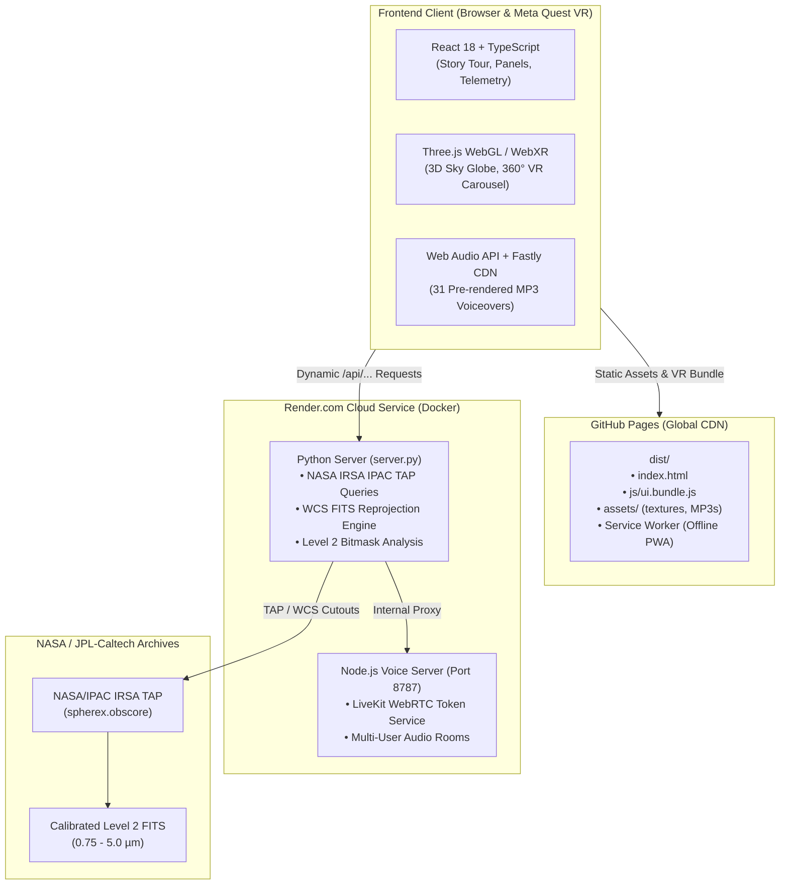

# SPHEREx Sky: The Sky, Again and Again

> **NASA Space Apps Challenge** — *Planet X and SPHEREx* Track  
> Developed by **Team PP.AP**  
> A browser-native 3D celestial observatory, multi-epoch FITS cutout pipeline, and time-domain discovery platform for NASA's 102-band infrared all-sky survey.

[](https://catagfx.github.io/SPHEREx_Sky/)
[](https://spherex-sky-backend.onrender.com/)
[](https://catagfx.github.io/SPHEREx_Sky/)
[](https://threejs.org/)
[](LICENSE.md)

---

## 🌐 Live Demonstrations

| Platform | URL | Capabilities |
| :--- | :--- | :--- |
| **Production Frontend** | **[https://catagfx.github.io/SPHEREx_Sky/](https://catagfx.github.io/SPHEREx_Sky/)** | 3D All-Sky Globe, Story Tour, 20 Constellations, 6 Benchmark Targets, WebXR Immersive Mode, 31 Pre-rendered Audio Voiceovers |
| **Cloud API & Voice Server** | **[https://spherex-sky-backend.onrender.com](https://spherex-sky-backend.onrender.com)** | Real-time NASA IRSA Level 2 Cutouts, WCS Reprojection, FITS Telemetry API, SMTP Delivery, LiveKit WebRTC Voice Gateway |
| **Meta Quest VR (WebXR)** | **[Open in Quest Browser](https://catagfx.github.io/SPHEREx_Sky/)** | 1-Click "Enter VR", 360° Floating Carousel, Controller Pointer & Hand Pinch Tracking, Upright Orbit Flight, Spatial Audio |

---

## 📑 Table of Contents

1. [Overview & Scientific Vision](#-overview--scientific-vision)
2. [Key Architecture & Features](#-key-architecture--features)
   - [3D Celestial Sphere & Dual-Layer Infrared Shader](#1-360-all-sky-celestial-globe-webgl--threejs)
   - [Meta Quest WebXR VR Observatory](#2-meta-quest-webxr-virtual-observatory)
   - [Classical Constellations & 31 Vocal Narrations](#3-classical-constellations--vocal-audio-pipeline)
   - [Time-Domain Target Explorer & Science Modes](#4-time-domain-target-explorer--scientific-analysis-modes)
   - [NASA IRSA IPAC On-Demand Cutout Pipeline](#5-on-demand-nasa-irsa-ipac-cutout--email-studio)
   - [LiveKit Voice Seminars & Collaborative VR](#6-livekit-voice-seminars--collaborative-vr)
3. [Benchmark Scientific Targets](#-benchmark-scientific-targets)
4. [Local Setup & Configuration Guide](#-local-setup--configuration-guide)
   - [Prerequisites](#prerequisites)
   - [1. Clone & Install Dependencies](#1-clone--install-dependencies)
   - [2. Start the Local Unified Server](#2-start-the-local-unified-server)
   - [3. Start with Frontend Development (Vite HMR)](#3-start-with-frontend-development-vite-hmr)
   - [4. Run in Local VR (HTTPS SAN Mode)](#4-run-in-local-vr-https-san-mode)
   - [5. Run Automated VR & E2E Test Suite](#5-run-automated-test-suite)
5. [Cloud Deployment Architecture (Option 2)](#-cloud-deployment-architecture)
6. [Known Limitations & Scientific Honesty](#-known-limitations--scientific-honesty)
7. [Team & Contributors](#-team--contributors)
8. [Data Attribution & Citation](#-data-attribution--citation)
9. [License & Intellectual Property](#-license--intellectual-property)

---

## 🔭 Overview & Scientific Vision

NASA's **SPHEREx** (Spectro-Photometer for the History of the Universe, Epoch of Reionization and Ices Explorer) maps the entire celestial sphere every 6 months across **102 near- and mid-infrared spectral bands** ($0.75\,\mu\text{m} - 5.0\,\mu\text{m}$).

**SPHEREx Sky** transforms this monumental dataset into a real-time, interactive celestial laboratory accessible from any desktop browser, mobile phone, or Meta Quest VR headset:
- **Spatial Dimension**: Seamlessly explore the 3D infrared sky with real celestial coordinates (RA/Dec and Galactic $l, b$).
- **Spectral Dimension**: Switch between near-infrared starlight ($0.75-1.6\,\mu\text{m}$) and mid-infrared interstellar dust/ice emission ($2.4-5.0\,\mu\text{m}$).
- **Temporal Dimension**: Track high-proper-motion stars, sub-stellar brown dwarf binaries, extreme dust-eclipsing variable stars, and hypothetical trans-Neptunian bodies across multiple survey epochs.

---

## ⚡ Key Architecture & Features



### 1. 360° All-Sky Celestial Globe (WebGL & Three.js)
- Renders NASA/JPL-Caltech SPHEREx survey maps on an inverted celestial sphere ($R = 500$).
- **Dual-Layer Shader**: Continuously blend between near-infrared stars/galaxies ($0.75-1.6\,\mu\text{m}$) and mid-infrared dust/ice features ($2.4-5.0\,\mu\text{m}$) with a live compare slider.
- **Precision Astrometry**: Fully functional coordinate conversion between equatorial $(\alpha, \delta)$ and galactic $(l, b)$ reference frames.
- **PWA & Offline-First**: Built-in Service Worker (`sw.js`) caches all essential assets, shaders, and textures for planetarium demonstrations without internet access.

### 2. Meta Quest WebXR Virtual Observatory
- **Full 6-DoF Immersive Exploration**: Native WebXR session supporting Meta Quest 2, 3, 3S, and Pro.
- **Dark Glass Floating UI**: Ergonomically anchored 360° carousel and wrist status panels at natural eye height ($y = 1.35\,\text{m}$ to $1.65\,\text{m}$).
- **Spatial Interaction**: Dual controller laser raycasting and natural hand pinch gestures.
- **Zero-Flicker Upright Travel**: Smooth 550 ms slerp navigation aligning target celestial directions without disorientation or disorienting roll.

### 3. Classical Constellations & 31 Vocal Audio Narrations
- **20 Classical Constellations**: 3D celestial figures rendered with additive line glow and star centroids on the sky globe.
- **Dedicated Tangent-Plane SVG Diagrams**: Project stars accurately even near celestial poles (e.g., Draco, Ursa Minor).
- **Dual Narration Engine**: 
  - **31 Pre-rendered Studio MP3 Voiceovers** (20 constellations + 11 landmarks) served with HTTP 206 Partial Content byte-range streaming.
  - Automatic fallback to Web Audio API buffer decoding and Web Speech API Synthesis for universal cross-platform playback.

### 4. Time-Domain Target Explorer & Scientific Analysis Modes
Six interactive analysis modes for investigating moving and variable infrared phenomena:
- `M` — **Multi-Epoch Blink**: Automated sequential playback across survey epochs to detect astrometric motion or brightness shifts.
- `S` — **Multi-Pass Split View**: Synchronized side-by-side epoch comparison.
- `B` — **Animated Blink Comparator**: High-contrast toggling to expose sub-pixel motion.
- `D` — **Difference Image Subtraction ($I_B - I_A$)**: Real-time digital subtraction isolating flux changes and moving residuals.
- `C` — **6-Band Infrared Spectrophotometry**: D1 through D6 spectral energy distributions (SED) with detector wavelength band bars ($0.75\,\mu\text{m}$ to $5.0\,\mu\text{m}$).
- `Z` — **Quality Bitmask Contamination Overlay**: Visualizes masked saturation cores (`BIT 1: 0x02`) and high-surface-brightness flags (`BIT 0: 0x01`).

### 5. On-Demand NASA IRSA IPAC Cutout & Email Studio
- Direct query integration with the **NASA/IPAC Infrared Science Archive (IRSA)** TAP interface (`spherex.obscore`).
- Real-time WCS reprojection onto a North-Up tangent plane via `scripts/find_and_cut_movers.py`.
- Automated animated GIF compilation and difference map generation.
- Optional SMTP email dispatch delivering full FITS packages directly to researchers.

### 6. LiveKit Voice Seminars & Collaborative VR
- Integrated WebRTC voice conferencing for classroom astronomy lectures and collaborative sky exploration.
- Host controls, dynamic speaker tokens, and microphone device selection.

---

## 🪐 Benchmark Scientific Targets

| Target | Scientific Classification | Coordinates (J2000) | SPHEREx Time-Domain Phenomenon |
| :--- | :--- | :--- | :--- |
| **Barnard’s Star** | High Proper Motion Red Dwarf (M4.0V) | $\alpha = 17^\text{h} 57^\text{m} 48.5^\text{s}$<br>$\delta = +04^\circ 41' 36''$ | Fastest known proper motion ($10.39''/\text{yr}$). Massive multi-pixel drift across SPHEREx 6-month survey passes. |
| **Epsilon Indi B** | Sub-Stellar Brown Dwarf Binary (T1 + T6) | $\alpha = 22^\text{h} 04^\text{m} 10.5^\text{s}$<br>$\delta = -56^\circ 46' 58''$ | Closest brown dwarf pair to Earth ($11.9\,\text{ly}$). Distinct cool methane absorption in detectors D3–D5. |
| **WISE 0855-0714** | Sub-Freezing Y-Dwarf ($T \approx 250\,\text{K}$) | $\alpha = 08^\text{h} 55^\text{m} 10.8^\text{s}$<br>$\delta = -07^\circ 14' 43''$ | Coldest known brown dwarf outside solar system ($7.4\,\text{ly}$). High proper motion ($8.1''/\text{yr}$) visible purely in thermal IR. |
| **RW Aurigae** | Young T Tauri Binary with Dust Eclipses | $\alpha = 05^\text{h} 07^\text{m} 49.5^\text{s}$<br>$\delta = +30^\circ 24' 05''$ | Dramatic circumstellar disk eclipses causing multi-magnitude drops in near-IR flux. |
| **R Draconis** | Mira Pulsating Variable Star | $\alpha = 16^\text{h} 32^\text{m} 40.2^\text{s}$<br>$\delta = +66^\circ 45' 18''$ | Periodic 245-day thermal pulsation with large amplitude variations across all 6 SPHEREx detectors. |
| **Planet X** *(Candidate)* | Hypothetical 450 AU Trans-Neptunian Body | $\alpha = 04^\text{h} 12^\text{m} 02.4^\text{s}$<br>$\delta = +18^\circ 30' 00''$ | Internal heat model ($T_\text{eff} \approx 42\,\text{K}$) with annual trigonometric parallax shift ($\pi = 458.4''$ baseline per 6 months). |

---

## 💻 Local Setup & Configuration Guide

### Prerequisites
- **Python**: `3.10` or higher
- **Node.js**: `18.x` or `20.x` (recommended)
- **Git**
- *Optional*: Modern WebXR-compatible browser (Google Chrome, Microsoft Edge, or Meta Quest Browser)

---

### 1. Clone & Install Dependencies

```bash
# Clone the repository
git clone https://github.com/catagfx/SPHEREx_Sky.git
cd SPHEREx_Sky

# Install Python backend dependencies
pip install -r requirements.txt

# Install Node.js frontend dependencies
npm install
```

---

### 2. Start the Local Unified Server

Run the Python unified server which serves the static web application, the IRSA cutout engine, and the FITS telemetry API:

```bash
python3 server.py 8080
```
Open **[http://localhost:8080/](http://localhost:8080/)** in your browser.

*(Optional)* Start the voice server for real-time LiveKit audio rooms:
```bash
node voice-server/server.js
```

---

### 3. Start with Frontend Development (Vite HMR)

If you are modifying React components, CSS, or shaders in `ui/src/`, use the unified development script:

```bash
# Starts both Python backend (:8080) and Vite dev server (:5173) with Hot Module Replacement
npm run dev
```
Open **[http://localhost:5173/](http://localhost:5173/)**.

To rebuild the production standalone bundle after modifying code:
```bash
npm run build:pages
```

---

### 4. Run in Local VR (HTTPS SAN Mode)

WebXR requires a secure context (HTTPS). To test on your Meta Quest headset over your local Wi-Fi:

```bash
# Generates local SSL certificates with LAN IP Subject Alternative Names
SPX_HTTPS=1 python3 server.py 8080
```
Then open `https://<YOUR_LAN_IP>:8080` in the **Meta Quest Browser**.

---

### 5. Run Automated Test Suite

SPHEREx Sky includes a headless Playwright test suite covering E2E workflows, user gestures, and simulated Quest 3 WebXR controller interactions:

```bash
# Run full automated test suite (18/18 VR tests + E2E checks)
npm test

# Run only the automated WebXR headset suite
node tests/vr.mjs
```

---

## ☁️ Cloud Deployment Architecture

The production platform operates as a modern **hybrid architecture**:

```
                  ┌───────────────────────────────────────────────┐
                  │                 USER / CLIENT                 │
                  │        (Desktop, Mobile, Meta Quest VR)       │
                  └───────────────┬───────────────┬───────────────┘
                                  │               │
     Static Web & WebXR Assets    │               │  Dynamic REST & Voice API
     (HTML, CSS, JS Bundle, MP3s) │               │  (/api/irsa-cutout, /api/rooms)
                                  ▼               ▼
                  ┌──────────────────────┐ ┌──────────────────────┐
                  │     GitHub Pages     │ │      Render.com      │
                  │   Fastly Global CDN  │ │     Cloud Docker     │
                  │                      │ │                      │
                  │ catagfx.github.io/   │ │ spherex-sky-backend. │
                  │ SPHEREx_Sky/         │ │ onrender.com         │
                  └──────────────────────┘ └──────────┬───────────┘
                                                      │
                                                      ▼
                                           ┌──────────────────────┐
                                           │    NASA IRSA IPAC    │
                                           │   Level 2 Archive    │
                                           └──────────────────────┘
```

1. **Frontend Hosting (GitHub Pages)**:
   - Configured via [`.github/workflows/pages.yml`](.github/workflows/pages.yml).
   - Automatically builds `npm run build:pages` and deploys on push to `main`.
   - Free worldwide CDN distribution with automatic SSL certificate provisioning.
2. **Backend Service (Render.com Docker Container)**:
   - Configured via [`Dockerfile`](Dockerfile) and [`render.yaml`](render.yaml).
   - Unified process runner via [`scripts/start-cloud.sh`](scripts/start-cloud.sh) orchestrates Python IRSA endpoints and Node.js voice gateway in a single container.
   - Built-in CORS headers allow seamless requests from `https://catagfx.github.io`.

---

## ⚖️ Known Limitations & Scientific Honesty

1. **Real NASA IRSA Observations vs. Planet X Model**:
   - All 5 moving and variable stars (**Barnard's Star**, **WISE 0855**, **Epsilon Indi B**, **RW Aurigae**, **R Draconis**) are powered by **real calibrated NASA/IPAC IRSA Level 2 Quick Release FITS files**.
   - **Planet X (450 AU)** is a hypothetical scientific candidate model demonstrating a calculated $458.4''$ annual trigonometric parallax baseline stacked over real SPHEREx Taurus ecliptic background frames.
2. **Live IRSA TAP Archive Coverage**:
   - For arbitrary coordinate searches, if NASA IRSA has no public multi-epoch coverage for that region, the platform transparently reports `status: "no_coverage"` instead of fabricating false science data. An optional illustrative mode can be enabled for classroom demonstrations, with every frame clearly stamped as synthetic.
3. **Browser Float Precision**:
   - In-browser difference imaging ($I_B - I_A$) operates on WCS-aligned display renders for instant 60 FPS scrubbing, while the Python pipeline (`scripts/find_and_cut_movers.py`) performs 32-bit floating-point FITS WCS reprojection.

---

## 👥 Team & Contributors

Proudly designed and developed for the **NASA Space Apps Challenge** by **Team PP.AP**:

### 🚀 Team PP.AP
- **Bocioc Marian-Catalin**
- **Tanase Filip Andrei**
- **Batrineanu Tudor Mihai**
- **Pupaza Andrei Cristian**
- **Toia Codrin Nicolae**

---

## 📜 Data Attribution & Citation

- **SPHEREx Mission & Level 2 Data**:  
  SPHEREx Science Team (2025), *SPHEREx Level 2 Quick Release Archive*, NASA/IPAC Infrared Science Archive, **DOI: [10.26131/IRSA629](https://doi.org/10.26131/IRSA629)**.
- **Orbital Ephemerides**: NASA JPL Horizons On-Line Ephemeris System.
- **Astrometric Cross-Matches**: ESA Gaia DR3, CDS SIMBAD, and AllWISE Infrared Catalog.
- **Audio Voiceovers**: Synthesized and mastered using educational voice models.

---

## 📜 License & Intellectual Property

SPHEREx Sky is **triple-licensed** under the terms of any of the following open-source licenses, at your choice:

| License | SPDX Identifier | Details |
| :--- | :--- | :--- |
| **MIT License** | `MIT` | Permissive: Use, modify, copy, and distribute freely. ([LICENSE-MIT](LICENSE-MIT)) |
| **Apache License 2.0** | `Apache-2.0` | Permissive with explicit patent protection and state changes notice. ([LICENSE-APACHE](LICENSE-APACHE)) |
| **GNU GPL v3.0** | `GPL-3.0-or-later` | Copyleft: Modified redistributed versions must remain open source under the GPL. ([LICENSE-GPL](LICENSE-GPL)) |

SPDX Expression: `MIT OR Apache-2.0 OR GPL-3.0-or-later`

See [LICENSE.md](LICENSE.md) for full terms, conditions, and third-party data service acknowledgments.

---

<p align="center">
  <b>SPHEREx Sky</b> • Standing inside NASA's infrared universe.<br>
  Crafted with passion by <b>Team PP.AP</b> for the NASA Space Apps Challenge.
</p>
